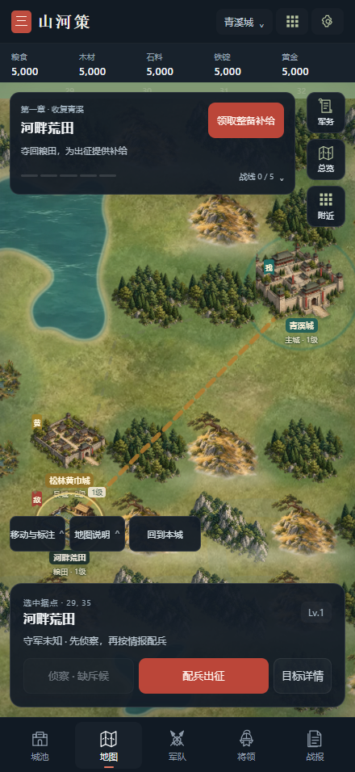
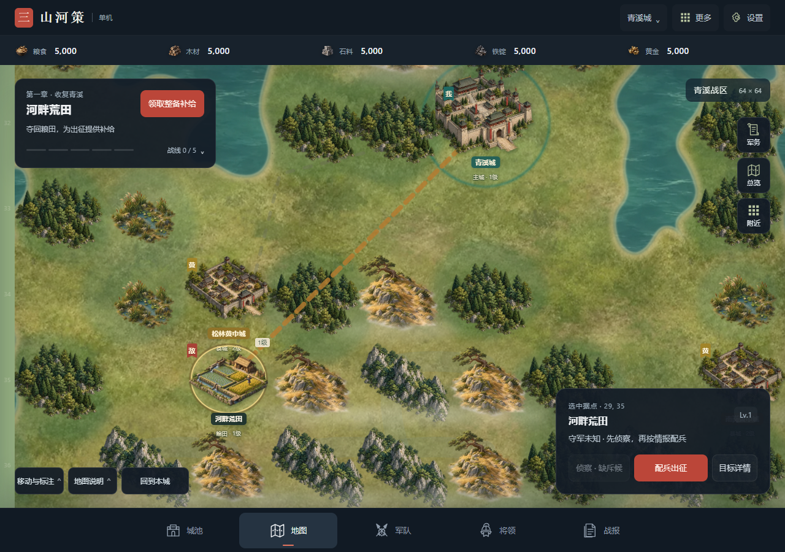

# 现代沙盘界面 v0.40.0 验证

完成日期：2026-11-04。负责人已选择「现代沙盘：全屏地图与轻量浮层」。范围为本机候选界面，设计见 `design/quick-specs/modern-ui-2026-11-03.md`。

## 结果

- 地图铺满主工作区，主线/行军放在左侧浮层，目标在右下或手机底部；军务、总览、附近及地图工具保持可访问。
- 统一炭灰、暖白、朱红控件；城建地块去掉重复的空地文字，保留原可访问名称；武将画像放大，手机上的详情/换装/调城改为横排。
- 全屏地图保持正方形世界比例并裁切，不拉伸地貌。手机视口为八格，起始视野同时包括主城与首章粮田；坐标、存档和规则未改。
- 新游戏军务为空时说明开放条件，并提供实际可用的当前目标入口。守城与区域战线通知独立显示，保留进入处理的操作。

## 浏览器检查

实际 Chromium：390×844、440×956、1280×900、844×390，均无文档横向溢出，新 HUD 触控按钮至少 44px。检查创建君主、退出演练、展开五阶段路线、拖动地图、点击主城进入城池、返回地图、空军务→当前目标、补给确认领取、城建、将领、设置，以及合法首胜存档的配兵。

同一浏览器第二标签页实际进入只读状态，显示存档保护与恢复操作；没有接管或更改原页面进度。配兵将实际兵数清零时开始按钮禁用且有原因，恢复 30 名已有弓兵后重新可出征。Tab/Shift+Tab 焦点可见，Enter 能打开真实补给窗口。

主操作颜色 `#bb4639` 与文字 `#fff5ef` 对比度约 4.83:1；次要文字 `#a9b5c1` 与面板 `#18222d` 约 7.71:1。使用 reduced-motion 检查，没有增加装饰动画。

## 自动与独立包

- 完整 Node 回归 **1184/1184 通过**，失败/取消/跳过均为 0。
- 两项取景预期从原六格更新到八格；局部地图带两格缓存边缘，实际读取 146 格，预算 160 格，未扫描全世界 4096 格；原纯平移预算保持不变。
- JavaScript 语法和 `git diff --check` 通过；版本索引、package.json、README 为 0.40.0。
- 独立包 136 个根文件 + 178 个素材，**314 个地址均 HTTP 200**；真实浏览器启动、创建君主、退出演练和版本确认通过，脚本错误为 0。
- 本轮只改引擎之后的界面脚本和样式，无需重新生成规则运行时；既有首章节奏与旧存档兼容回归通过。

界面证据见 `assets/modern-ui-v0.40.0/evidence.json`，对应图片均实际查看。实体 iPhone Safari、安卓真机与 GPU 帧率未验收；本批未合并上线。

