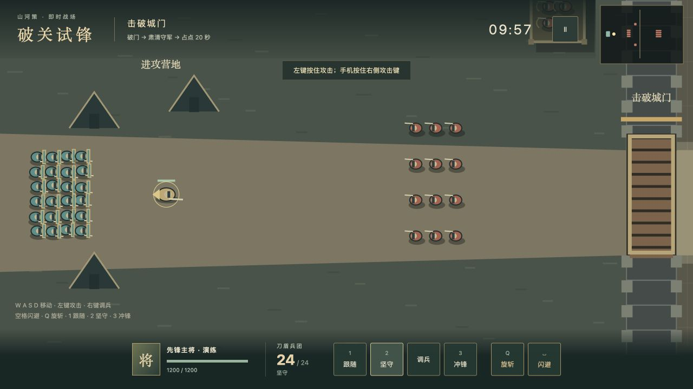
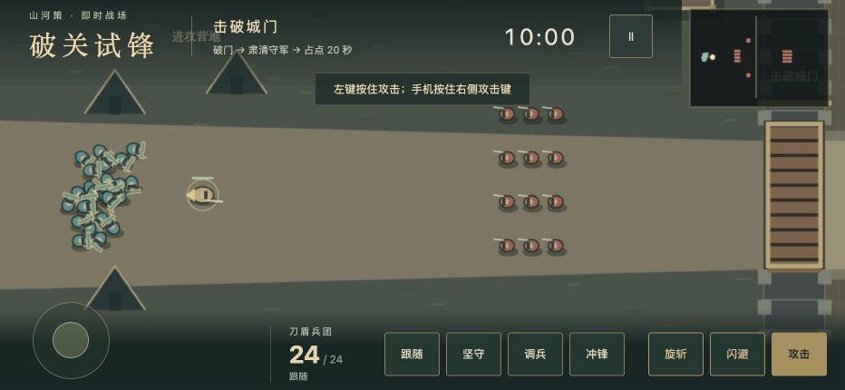

# 实时攻城首战验收记录

日期：2026-10-29。当前阶段：整分支独立审查前。

## 已验证

- 首次全量回归：1167 项全部通过（补装仓库已有 PGlite 开发依赖后）。最终审查修复后再记录完整结果。
- 新增规则、导航、主将交战、兵团命令、门/据点、后方事务、快照校验、写失败重试、写入锁接管、输入和固定步长测试。
- 实际 IAB 浏览器由城建入口进入演练、开始、坚守、暂停、退出；控制台未发现新增错误。
- 浏览器 932×430 横屏有摇杆、攻击/技能/兵团按钮；转为 430×932 后出现“请将手机横过来，战斗已暂停”。这是桌面浏览器视口检查，不是实体手机验证。
- 自然命令轨迹：不修改生命、位置、门血或结果；主将攻击与技能配合跟随兵团，清外营/箭台、破门、清城内并占点，在 479 秒获胜，主将剩 476 生命，刀盾幸存 24。无操作在 600 秒超时失败。
- 模拟性能和完整终局见 evidence/realtime-siege-first-battle/natural-input-simulation.json。Node 的 P50/P95 是纯模拟耗时，不代表浏览器绘制帧率。

## 表现与实现选择

原生 Canvas 二维矢量地图、朝向明确的兵团、命中/技能反馈、有限特效池、Web Audio 合成音效和静音按钮；不依赖外部素材。没有相机震动。规则、纯模拟、导航、后方系统、Canvas 视口和 DOM 界面各自独立。

## 尚未验证

- 实体 iPhone 17 Pro Max Safari 的双指输入、声音恢复、安全区域及连续 10 分钟帧率/内存。当前环境没有可操作的实体 iPhone，不能声明已通过。
- 真人长期数值与好玩性平衡。脚本 479 秒通关证明存在合法路径，不能替代真人试玩。
- 当前版本未合并 main 或发布 GitHub Pages。

## 截图

