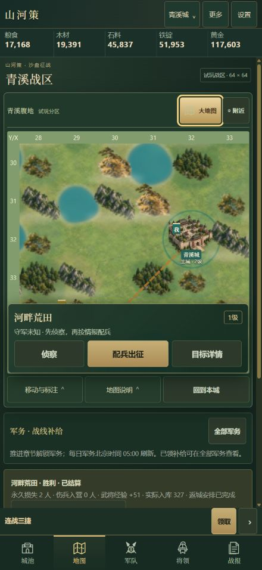
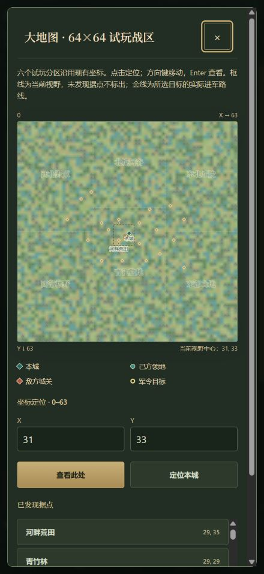

# 山河策沙盘征战 v0.38.0 验收

日期：2026-10-23。基线：`07d59760e105f1722e96ddc3c78a125527820299`（v0.37.1）。范围为负责人批准的玩法、地图、美术同步改版。当前为开发候选，尚未合并发布。

## 自动与数值检查

- `node scripts/build-online-runtime.cjs` 成功：54 个源文件，源摘要 `78121078ba5e`。
- Windows Node v24.21.0 下运行 `npm test`：1179 项，全部通过，失败/取消/跳过均为 0，约 48 秒。测试包含本机联机服务器与 PGlite SQL 检查。
- 新规则 17 项覆盖报价、快照、实际胜负、迁移、日界、跨日任务、领取幂等、非法存档拒绝和保存失败回滚；界面投影与地图触控、缓存、路径兼容一并检查。
- 独立代码复核发现的两处 P2 已修复：尚不可见的控制关隘不暴露名称和坐标；折返重叠路线召回按累计进度保留实际经过的路径。相关回归均通过。
- 同脚本同参数对照主分支与候选：第三章均 198.67804083333334 小时，14 场战斗的目标、结果和时点一致，差为 0。后续日军务扣除口粮后仍有正收益。完整预算和测量口径见[数值报告](../../design/balance/sandbox-campaign-2026-10-23.md)。

## 真实浏览器操作

在本地 HTTP 服务、ChatGPT 内置 Chromium 浏览器操作实际游戏，未通过页面脚本直接改状态。

1. 新档默认进入地图，原新手引导可正常操作。随后用既有首战机器人通过普通建设、训练与所得加速道具得到的合法首胜存档，经设置的正式文件导入流程导入。无兑换码物资、预设伤害或额外部队。
2. 军务选择护粮，目标跳转到真实河畔荒田。配兵清除义兵和斥候后保留 30 弓兵；官道报价 10 秒 / 56 粮，乡道 13 秒 / 48 粮。选择乡道出发，粮食 15,759 → 15,711，实际扣 48。
3. 抵达进入战斗，暂停倒计时后逐回合操作。第三回合胜利，2 人永久损失，0 伤兵，28 人幸存，主将经验 +51，普通战利品 327。返回地图及返城完成后，护粮变为可领取。
4. 点击领取，粮食 15,968 → 17,168，实际增加 1,200；军务标记消失，任务不会重复领取。军务列表保留后续每日刷新说明。
5. 侦察预览显示本城 1 斥候、去返各 2 秒、口粮 13；确认后扣粮 13。抵达后目标情报变为“已知兵种”，未显示该精度不允许的兵数及资源数量。
6. 检查 390×844 与 440×956 视口，页面无横向溢出，目标短卡包含侦察/配兵/详情，底部五入口保留。展开详情只有一组实际操作；地图工具折叠后为 44 像素单行。桌面确认地图与目标并排显示。
7. 更多各分类上方保留行囊、商城快捷入口。实际打开名将册，关羽、黄忠、马超均使用 `assets/sandbox/*.webp` 的可信身份画像；普通将领保留原头像。

浏览器曾有截图和鼠标输入连接超时；更换同一浏览器的新预览标签并正常接管测试存档后恢复，最终截图和普通点击均可用，未修改游戏以绕过此工具问题。

## 实际画面

390 像素手机：

440 像素手机：

战区总览：

## 美术与发布边界

原创山脉、树林、关隘、县城、郡城和主城图集，以及关羽、黄忠、马超人物图集，均用内置 image_gen 制作；保留源 PNG，经等格裁切、透明边缘裁切后编码为 WebP。完整提示词、生成记录和尺寸清单见[素材说明](../../assets/sandbox/README.md)。此轮没有复制其他游戏图像。

地图仍为 64×64 试玩世界，六个分区不冒充完整历史全国地图。新军务提供每日有限的补给和补兵选择，官府 7→8 原约 27.1 小时工期未缩短。仅做 Chromium 响应式检查，实体 iPhone Safari 验收仍待进行。发布须经负责人明确指令后合并。
