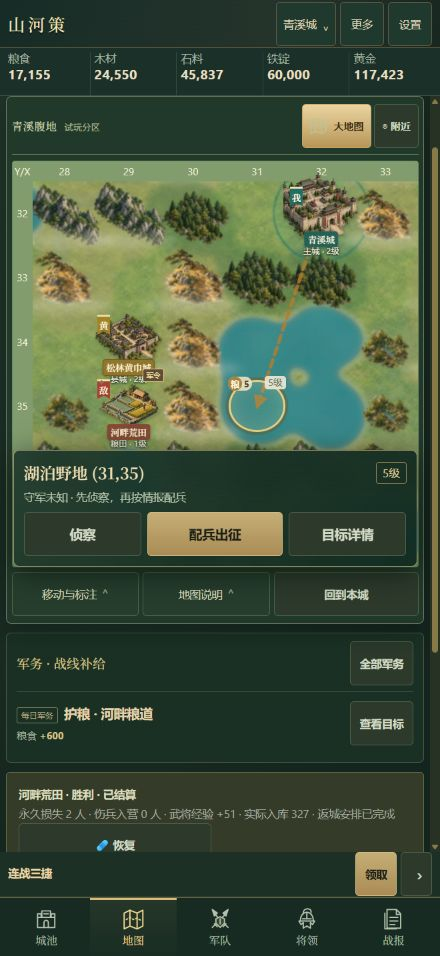
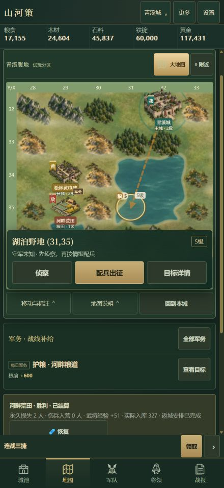
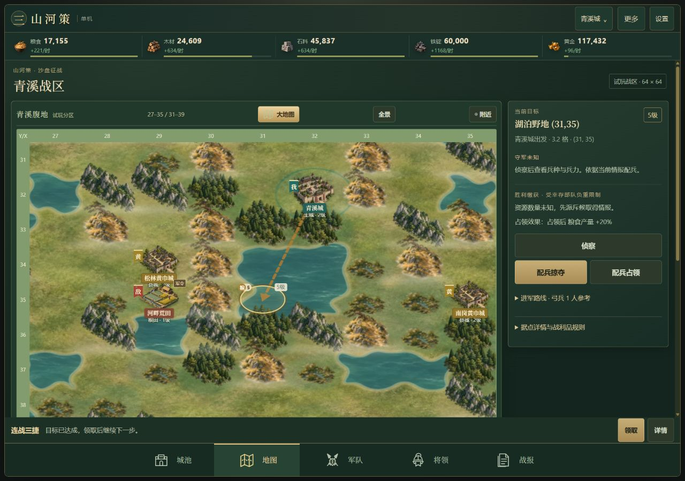

# 水面与草地补充验收 · 2026-10-24

根据负责人“水和草地也要改”的要求，继续更新 v0.38.0 候选与同一拉取请求，不单独发布。

## 变化

- 新增原创 `water-v2.webp`、`grass-v2.webp`，水面为翡翠青细波纹，草地为橄榄青绿草甸。两张768×768材质合计181,872字节；完整源图和最终提示词见[素材记录](../../assets/sandbox/README.md)。
- 相邻真实湖泊先合并外缘，再按世界坐标生成不对称浅弯和少量深湾，叠加沙岸、浅水与深水；对角水格不会假连成河道。纹理与弯点均锚定世界坐标，未改变任何地块、守军、行军或存档规则。
- 草地减少旧材质的高频噪点及重复细草点，扩大平铺周期，增加低频色彩层次。战区总览同步水草色系。
- 水草各使用独立 `v=2` 资源键，统一预加载、SVG内联与预绘画布；保留2格边缘缓冲、8个Blob URL缓存上限及回收、DPR限制、手机滤镜降级。无逐帧水波动画。

## 检查

- `npm test`：**1180/1180通过**，失败、取消、跳过均为0，Windows Node v24.21.0约65秒。既有地图、触控、预加载/内联、格式回退检查通过；新增一项联合轮廓、对角分离和世界坐标一致性检查。
- `node --check` 与 `git diff --check` 通过。修改的渲染脚本在 `engine.js` 之后，隔离规则运行时源未变。
- 实际Chromium浏览器检查390×844、440×956、1280×900。同一(31,35)镜头对照水草前后效果，实际拖动向右再向左各80像素，地图坐标按格移动和返回，目标保持原选择。
- 新地图实际落为 `CANVAS.ink-ground-image`，未退回每帧滤镜；390宽文档宽度仍为390，440宽无横向溢出，控制台错误为0。
- 使用真实湖泊(31/32,34/35)查看多格联合湖岸，人工排除首版圆角矩形及第二版等幅小湾，最终采用浅弯为主、少量深湾。
- 独立试玩包保留旧包并另存水草更新包；134个首页资源均存在且与源码一致，运行时含两张新WebP，未带入源PNG、提示词、测试档或敏感配置。
- 独立包实际启动，包含首页、134个引用资源及12个地图预加载图像的147个地址均HTTP200；真实浏览器启动无脚本错误。

实体iPhone Safari尚待检查。正式上线仍按负责人发布指令执行。

## 实际手机对照

修改前：

修改后：

桌面：

